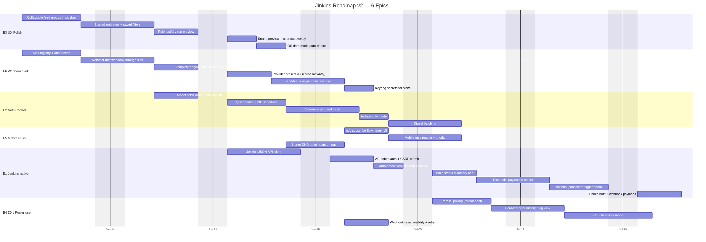
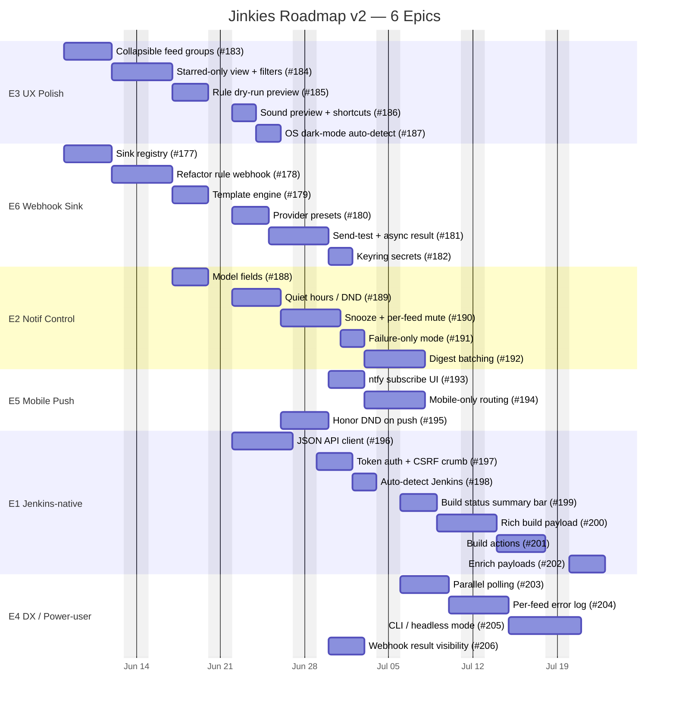
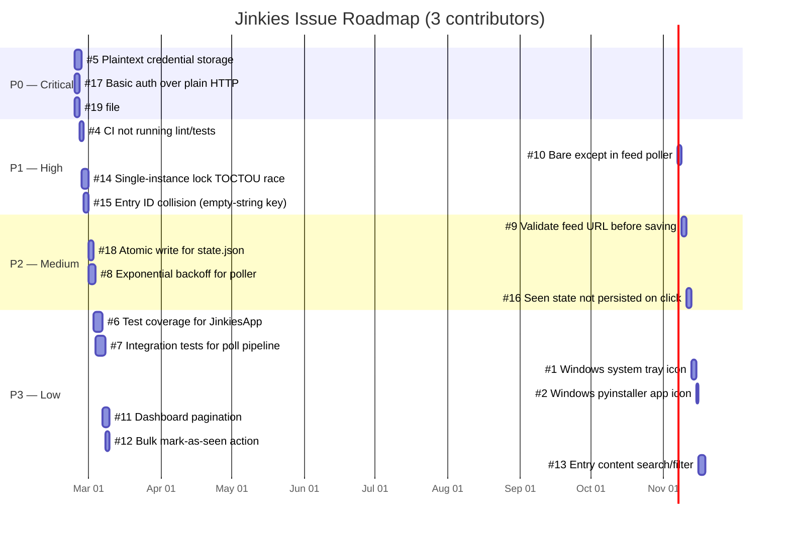

# Jinkies Roadmap

## v2 — Feature Epics

All v1 issues shipped. v2 adds six epics tracked as GitHub milestones (E1–E6).
Tracking issue: [#207 Roadmap v2](../../issues/207).

| Epic | Milestone | Theme |
|------|-----------|-------|
| E1 | Jenkins-native mode | Talk to Jenkins JSON API for rich build data, actions, auto-detect |
| E2 | Notification control | DND/quiet hours, snooze, per-feed mute, failure-only, digest |
| E3 | Dashboard UX polish | Collapsible groups, starred view, rule preview, sound preview, OS dark-mode |
| E4 | DX / power-user | Parallel polling, error log, CLI/headless, webhook result visibility |
| E5 | Mobile push | Phone notifications (ntfy etc); mobile-only routing |
| E6 | Universal webhook sink | One configurable HTTP sink + presets (Discord/Slack/ntfy) |

**Dependency spine:** E6 (sink layer) underpins E5 mobile, E2 digest, E4 retry-visibility.
E3 runs concurrent with E6 (independent files). E1 is a parallel net-new track; its build
payload (E1g) feeds E6 template vars. E4 (refactor-heavy) lands last.

Gantt source (mermaid)

> Dates are illustrative sequencing (solo-dev pace, ~2–5 d/task), not commitments.

## v1 — Initial hardening (shipped)

